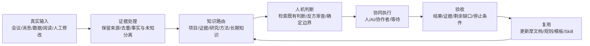

# Soya 个人知识库整理方法

**帮你把散乱笔记整理成以后找得到、能帮助判断和行动的资料。**

## 不会编程也可以开始

这里的 **Skill** 是“让 AI 按固定步骤做事的说明包”；**Prompt** 是“可以复制给 AI 的一段指令”。你可以先用下面的指令体验方法，不必先安装工具。

1. 打开你平时使用的 AI 聊天工具，开始一段新对话。
2. 复制下面整段文字，换掉方括号里的示例；只用你有权分享的个人材料。
3. 发送后对照“应该看到什么”检查结果。信息不够时，AI 应先提问，不应编造。

```text
请把这条虚构阅读笔记整理成一张以后找得到、用得上的卡片：[书中建议每次只改一个习惯；我想连续三天睡前读十分钟]。写出原始说法、我的理解、还不确定的地方、下一步和复查日期。不要编造来源。
```

**应该看到什么：** 你应得到一张笔记卡片，并知道下一步做什么。先把它存进你熟悉的笔记软件即可；暂时不用安装 Obsidian 或编程工具。

AI 聊天工具可能收费，发给它的内容按该服务的规则处理；不要粘贴工作机密、私人联系方式或密码。结果不符合预期时，告诉 AI 哪一项缺少，并补充非敏感信息；你可以随时停止。

后面的安装和开发说明是进阶内容，可以先跳过。“提交问题（Issues）”指仓库顶部的提问区；只填写去除私人和工作信息的说明。


### 用本地 Markdown、Obsidian 与 Codex，把信息变成可追溯的判断、行动与持续成长

**A local-first personal knowledge system for turning information into traceable decisions and reusable work.**

[English](README.en.md) · [30 天搭建路线](docs/09-30-day-build.md) · [模板](templates/) · [完整示例](examples/end-to-end-example.zh-CN.md)


---

## 这是什么

很多个人知识库最后会变成三个东西：收藏夹、文件仓库、AI 输出堆。

SOYA-个人自增强知识库系统搭建是一套面向知识工作者的本地优先方法，用来解决以下问题：

- 信息很多，怎样保留来源又不被噪声淹没？
- 项目材料、会议记录、长期知识和 AI 方法怎样各归其位？
- 怎样让 Codex 读懂已有背景、继续维护同一份文档，而不是反复新建？
- 怎样区分“AI 写出来了”“人读过了”“结论被证据支持”“事情真正完成了”？
- 怎样把一次纠正沉淀成下一次任务会自动遵守的规则？

核心判断：**知识库的价值不在于存了多少，而在于下一次做判断时，能否快速找到可信上下文、看到变化过程，并完成真实行动。**

## 系统全景



这套系统有两条互相咬合的主线：

1. **知识线**：输入 → 证据 → 路由 → 判断 → 复用。
2. **行动线**：目标 → 下一步 → 下一棒 → 验收证据 → 关闭或继续。

知识线保证 AI 不空转，行动线保证知识不会只停在文档里。

## 自增强知识闭环

```text
Log       记录输入    让 AI 看见真实材料与上下文
Orient    定向判断    检索旧判断、识别反例、由人做取舍
Operate   协同执行    把判断变成具体动作与可验收产物
Preserve  沉淀复用    把结果、失败和边界写回系统
```

| 环节 | 关键问题 | 最小产物 |
|---|---|---|
| Log | AI 是否看到了真实、具体、带来源的材料？ | 来源、日期、上下文、缺失项 |
| Orient | 哪个判断成立？证据与反例是什么？ | 当前判断、置信度、数据缺口 |
| Operate | 谁现在能推进？完成标准是什么？ | 下一步、执行者、验收标准 |
| Preserve | 什么值得让下一次任务继续使用？ | 厚文档增量、规则或模板 |

## 八条关键经验

1. **先按用途分层，再按主题分类。** 项目事实、原始证据、长期知识和 AI 方法承担不同职责，混在一起会让检索失真。
2. **一个主题只保留一个活跃正文。** 更新厚文档，少建“最终版”“最新版”和平行摘要。
3. **来源可靠性与结论置信度分开。** 一手来源也可能不支持当前具体结论；模型总结只能作为线索。
4. **状态必须描述现实。** `blocked`、`partial`、`waiting` 与 `done` 含义不同；“已配置”不能冒充“已产生结果”。
5. **内部链接服务于调用。** 每篇新笔记同时拥有出链和导航入链，孤立文件等于不可用资产。
6. **让 Codex 继承规则，不让它猜。** 用 `AGENTS.md` 保存长期协作约定，用任务提示补本次目标、范围和验收。
7. **AI 访问过不等于人读过。** 阅读状态、来源核验、AI 制作进度是三件事；知识能否迁移应用还要另验。
8. **自动化只承接稳定流程。** 先跑通输入、输出、异常、验收和停止条件，再安排定时执行。

## 推荐目录

```text
KnowledgeOS/
├── 00_System/          # 总览、规则、导航、模板
├── 10_Projects/        # 当前项目与唯一活跃厚文档
├── 20_Evidence/        # 会议、原始数据、访谈与回执
├── 30_Research/        # 外部行业、用户和主题研究
├── 40_AI_Methods/      # Prompt、工作流、Skill、自动化与案例
├── 50_Knowledge/       # 跨项目稳定知识与判断
├── 60_Growth/          # 学习、复盘、阅读和长期成长
└── 90_Inbox/           # 归属暂不明确，等待处理
```

编号不是重点。重点是每个目录回答不同问题：

- `Projects`：现在正在推进什么？
- `Evidence`：事实从哪里来？
- `Research`：外部世界出现了什么信号？
- `AI Methods`：怎样稳定地用 AI 做事？
- `Knowledge`：哪些跨项目判断值得长期调用？
- `Growth`：哪些能力需要长到自己脑子里？

完整解释见 [知识架构](docs/03-knowledge-architecture.md)。可直接复制的最小目录在 [starter-vault](starter-vault/)。

## 快速开始

### 1. 复制最小 Vault

```bash
cp -R starter-vault MyKnowledgeOS
```

### 2. 定义三类边界

- 哪些内容只保留本地？
- 哪些动作 AI 可以直接执行？
- 什么证据才算任务完成？

### 3. 把协作规则交给 Codex

复制 [`templates/AGENTS.example.zh-CN.md`](templates/AGENTS.example.zh-CN.md) 到工作目录，再按实际场景删改规则。官方文档说明 Codex 会读取全局与项目级 `AGENTS.md`，更靠近当前目录的规则优先。[OpenAI 官方说明](https://developers.openai.com/zh-Hans/docs/agent-configuration/agents-md)

### 4. 从一条真实链路开始

不要先迁移全部历史文件。先选一个稳定重复任务，例如：

```text
一场会议
→ 一份带来源的会议记录
→ 更新一个项目厚文档
→ 形成一个下一步
→ 用真实回执验收
→ 写回一条可复用判断
```

参照 [完整虚构示例](examples/end-to-end-example.zh-CN.md) 跑一遍，再扩展。

## 文档地图

| 文档 | 回答的问题 |
|---|---|
| [系统总览](docs/01-system-overview.md) | 整套系统由哪些层组成？ |
| [信息获取与证据处理](docs/02-information-pipeline.md) | 多来源信息怎样进入系统又不污染事实？ |
| [知识架构](docs/03-knowledge-architecture.md) | 文件放哪里，为什么？ |
| [Codex 协作](docs/04-codex-collaboration.md) | 怎样让 AI 自主执行，同时守住范围和质量？ |
| [质量与治理](docs/05-quality-and-governance.md) | 怎样管理来源、版本、状态、链接和验收？ |
| [阅读与内化](docs/06-reading-and-internalization.md) | 怎样避免“文档越来越多，自己没有变强”？ |
| [自动化与扩展](docs/07-automation-and-scaling.md) | 什么值得自动化，怎样防止噪声和假完成？ |
| [隐私与公开](docs/08-privacy-and-publication.md) | 怎样把私人系统变成可公开项目？ |
| [30 天搭建路线](docs/09-30-day-build.md) | 从零开始按什么顺序搭建？ |

## 自带模板

- [`AGENTS.example.zh-CN.md`](templates/AGENTS.example.zh-CN.md)：Codex 长期协作规则。
- [`routing-card.zh-CN.md`](templates/routing-card.zh-CN.md)：新建或移动文件前的路由判断。
- [`knowledge-note.zh-CN.md`](templates/knowledge-note.zh-CN.md)：带来源、置信度和阅读状态的知识笔记。
- [`source-evaluation.zh-CN.md`](templates/source-evaluation.zh-CN.md)：来源可靠性与结论置信度分级。
- [`adversarial-review.zh-CN.md`](templates/adversarial-review.zh-CN.md)：失败路径、用户反例与数据缺口审查。
- [`work-completion.zh-CN.md`](templates/work-completion.zh-CN.md)：避免“做了动作却没有结果”的验收卡。

## 哪些指标值得看

不要用文档数量和 AI 调用次数证明成熟度。优先观察：

- 找到正确上下文所需时间；
- 重复解释背景和重复建文档的次数；
- 因来源不清、状态误判导致的返工；
- AI 错误关闭任务、重复提醒和遗漏的比例；
- 某条知识被实际调用后，是否改善了判断或结果；
- 人能否在没有完整 AI 答案时，独立解释关键判断。

## 适用与不适用

适合：

- 同时处理多个项目、会议、研究和长期学习的知识工作者；
- 希望让 AI 读写本地知识库，但重视来源、隐私和可回滚；
- 已经积累大量 Markdown，却缺少稳定入口和反馈闭环的人。

不适合：

- 只想收藏链接，不打算回到真实任务；
- 希望 AI 自动判断自己是否读懂、自动替代最终决策；
- 不愿维护任何来源、状态和验收证据，却期待知识长期可靠。

## 隐私与安全

本仓库只包含通用方法、虚构案例与脱敏模板，不包含：

- 真实公司、项目、同事、客户或用户信息；
- 内部链接、账号、Cookie、Token、API Key；
- 本机绝对路径、私有知识库目录和真实业务数据；
- 未经授权的会议、消息、截图或原始材料。

提交前运行：

```bash
python3 scripts/privacy_scan.py .
python3 -m unittest discover -s tests -v
```

更完整的公开边界见 [隐私与公开](docs/08-privacy-and-publication.md) 和 [SECURITY.md](SECURITY.md)。

## 项目边界

本项目只讨论知识库的结构、证据、判断、阅读、协作与治理。具体公司的业务流程、内部系统、个人日程和私有自动化不在公开范围内。

## 说明

这是一套个人实践方法，不是 Obsidian 或 OpenAI 的官方框架。项目只使用公开文档描述产品能力：

- [Obsidian Help](https://help.obsidian.md/)
- [OpenAI：使用 AGENTS.md 自定义 Codex](https://developers.openai.com/zh-Hans/docs/agent-configuration/agents-md)
- [OpenAI：Codex customization](https://developers.openai.com/docs/customization/overview)

## License

[MIT](LICENSE) © SOYA


[维护与恢复](MAINTENANCE.md) · 本轮规范检查尚未完成公开发布验收。
